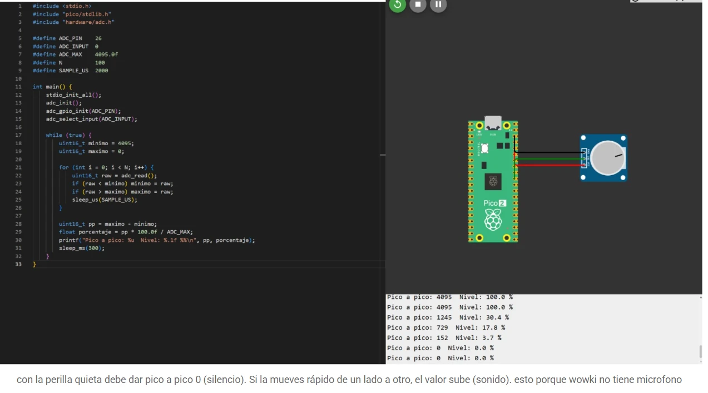

# ADC — Reading a Light Sensor, a Temperature Sensor, a Potentiometer and a Microphone

**Goal (one sentence):** Use the Pico 2's analog-to-digital converter to read four analog signals — a photoresistor, an NTC thermistor, a potentiometer and a microphone — and turn each raw reading into a physical value: lux, degrees Celsius, knob position and sound level.

**Prediction — written before running anything:** The ADC is 12-bit, so every reading should fall between 0 and 4095 and map linearly to 0–3.3 V. For the potentiometer that voltage is the measurement itself, so the percentage should follow the knob directly. The photoresistor and the thermistor are not linear: each sits in a voltage divider, so the program first has to recover the sensor's resistance from the voltage and only then apply its own equation — the gamma model for the LDR and the Beta equation for the NTC. If the equations are right, the values printed should match the light level and the temperature set in the simulator. A microphone is different: a single reading says nothing about loudness, because sound is a signal that swings up and down, so the level has to come from the spread between the highest and lowest reading over a short window — zero in silence and larger the stronger the signal.

---

### Setup

- Simulated in Wokwi on a Raspberry Pi Pico 2; one sensor at a time.
- Each sensor module powered from 3.3 V and GND, with its analog output on GP26 (`ADC_PIN` = 26, `ADC_INPUT` = 0, i.e. ADC0).
- Conversion constants shared by the programs: `VREF` = 3.3 V and `ADC_MAX` = 4095.
- Wokwi has no microphone part, so for that exercise a potentiometer stands in for it: holding the knob still plays the role of silence, and turning it quickly back and forth plays the role of sound.

### What I did

1. Wrote one program per sensor, all starting the same way: `adc_init()`, `adc_gpio_init(ADC_PIN)` to put GP26 in analog mode, and `adc_select_input(ADC_INPUT)` to pick channel 0.
2. In each loop, took a reading with `adc_read()` every 500 ms and converted it to voltage with `raw * VREF / ADC_MAX`.
3. **Potentiometer:** turned the reading into a position from 0 % to 100 % (`raw * 100 / ADC_MAX`) and turned the knob to watch it change.
4. **NTC thermistor:** computed the resistance ratio from the reading, `1 / (ADC_MAX / raw - 1)`, and applied the Beta equation (`BETA` = 3950, referenced to 25 °C = 298.15 K), discarding readings at 0 or 4095 as out of range.
5. **Photoresistor (LDR):** recovered the LDR's resistance from the divider with the 10 kΩ fixed resistor, `R_FIXED * raw / (ADC_MAX - raw)`, and converted it to lux with the module's gamma model (`GAMMA` = 0.7, `RL10` = 50 kΩ at 10 lux), discarding readings at 0 or 4095 as out of range.
6. Used `logf` and `powf` from `math.h` for the logarithm in the Beta equation and the power in the gamma model. A first version computed them with our own series functions (`ln_propio` and `exp_propio`); it is the one in the LDR and NTC screenshots, and it gives the same readings.
7. Moved the light and temperature sliders in the simulator and compared them with the values printed on the serial monitor.
8. **Microphone (improvised with a potentiometer):** took `N` = 100 readings 2 ms apart (`SAMPLE_US` = 2000, a 200 ms window), kept the minimum and maximum, and printed the peak-to-peak difference and its percentage of the full scale every 300 ms. Then left the knob still and turned it quickly to see the level rise and fall.

### What went wrong

- We lost a lot of time on the first, physical version of the practice: the sensor we used was a different one and it did not work. The code was not the problem — when we moved it to the simulation, everything worked as it should, so we decided to do the whole practice in simulation.

---

## Light sensor (LDR)

### Code

```c
#include <stdio.h>
#include <math.h>
#include "pico/stdlib.h"
#include "hardware/adc.h"

#define ADC_PIN    26
#define ADC_INPUT  0
#define VREF       3.3f
#define ADC_MAX    4095.0f
#define R_FIXED    10000.0f
#define GAMMA      0.7f
#define RL10       50.0f

int main() {
    stdio_init_all();
    adc_init();
    adc_gpio_init(ADC_PIN);
    adc_select_input(ADC_INPUT);

    while (true) {
        uint16_t raw = adc_read();
        float v = raw * VREF / ADC_MAX;

        if (raw > 0 && raw < 4095) {
            float r_ldr = R_FIXED * raw / (ADC_MAX - raw);
            float lux = powf(RL10 * 1000.0f * powf(10.0f, GAMMA) / r_ldr, 1.0f / GAMMA);
            printf("ADC: %u  V: %.3f  R: %.0f ohm  Luz: %.1f lux\n", raw, v, r_ldr, lux);
        } else {
            printf("ADC: %u  fuera de rango\n", raw);
        }
        sleep_ms(500);
    }
}
```

### Evidence

The simulator's light level is set to 145 lux; the program reads ADC 1782, 1.436 V and a resistance of 7704 Ω, and computes **144.7 lux**.


---

## Temperature sensor (NTC)

### Code

```c
#include <stdio.h>
#include <math.h>
#include "pico/stdlib.h"
#include "hardware/adc.h"

#define ADC_PIN    26
#define ADC_INPUT  0
#define VREF       3.3f
#define ADC_MAX    4095.0f
#define BETA       3950.0f

int main() {
    stdio_init_all();
    adc_init();
    adc_gpio_init(ADC_PIN);
    adc_select_input(ADC_INPUT);

    while (true) {
        uint16_t raw = adc_read();
        float v = raw * VREF / ADC_MAX;

        if (raw > 0 && raw < 4095) {
            float tempC = 1.0f / (logf(1.0f / (ADC_MAX / raw - 1.0f)) / BETA + 1.0f / 298.15f) - 273.15f;
            printf("ADC: %u  V: %.3f  T: %.2f C\n", raw, v, tempC);
        } else {
            printf("ADC: %u  fuera de rango\n", raw);
        }
        sleep_ms(500);
    }
}
```

### Evidence

The simulator's temperature is set to 50.3 °C; the program reads ADC 1072 and 0.864 V and computes **50.31 °C**.


---

## Potentiometer

### Code

```c
#include <stdio.h>
#include "pico/stdlib.h"
#include "hardware/adc.h"

#define ADC_PIN    26
#define ADC_INPUT  0
#define VREF       3.3f
#define ADC_MAX    4095.0f

int main() {
    stdio_init_all();
    adc_init();
    adc_gpio_init(ADC_PIN);
    adc_select_input(ADC_INPUT);

    while (true) {
        uint16_t raw = adc_read();
        float v = raw * VREF / ADC_MAX;
        float porcentaje = raw * 100.0f / ADC_MAX;
        printf("ADC: %u  V: %.3f  Posicion: %.1f %%\n", raw, v, porcentaje);
        sleep_ms(500);
    }
}
```

### Evidence

With the knob near the middle, the program reads ADC 1957 and 1.577 V, a position of **47.8 %**.


---

## Microphone (improvised with a potentiometer)

### Code

```c
#include <stdio.h>
#include "pico/stdlib.h"
#include "hardware/adc.h"

#define ADC_PIN    26
#define ADC_INPUT  0
#define ADC_MAX    4095.0f
#define N          100
#define SAMPLE_US  2000

int main() {
    stdio_init_all();
    adc_init();
    adc_gpio_init(ADC_PIN);
    adc_select_input(ADC_INPUT);

    while (true) {
        uint16_t minimo = 4095;
        uint16_t maximo = 0;

        for (int i = 0; i < N; i++) {
            uint16_t raw = adc_read();
            if (raw < minimo) minimo = raw;
            if (raw > maximo) maximo = raw;
            sleep_us(SAMPLE_US);
        }

        uint16_t pp = maximo - minimo;
        float porcentaje = pp * 100.0f / ADC_MAX;
        printf("Pico a pico: %u  Nivel: %.1f %%\n", pp, porcentaje);
        sleep_ms(300);
    }
}
```

### Evidence

With the knob still, the peak-to-peak value is 0 (silence). Turning it quickly makes it jump — up to 4095 (100 %) on a full sweep, and values such as 1245 (30.4 %), 729 (17.8 %) or 152 (3.7 %) on smaller movements — and it drops back to 0 as soon as the knob stops.

<video controls width="100%" src="../recursos/videos/parcial3-practica1-microfono.mp4"></video>



---

## Results

| Sensor | Set in the simulator | ADC | Voltage | Computed by the program |
|---|---|---|---|---|
| Photoresistor (LDR) | 145 lux | 1782 | 1.436 V | 144.7 lux (R = 7704 Ω) |
| NTC thermistor | 50.3 °C | 1072 | 0.864 V | 50.31 °C |
| Potentiometer | knob near the middle | 1957 | 1.577 V | 47.8 % |
| Microphone (potentiometer) | knob still / turned quickly | 0 to 4095 peak-to-peak | — | 0.0 % to 100.0 % |

### Open Question

The readings land within 0.3 lux and 0.01 °C of the simulator, and the first version, with our own series instead of `logf` and `powf`, gave the same numbers — so the math is not where the error is. What is left comes from the ADC: one 12-bit step is about 0.8 mV, and because the LDR and NTC curves are steepest near the ends of the range, that same step turns into a much larger jump in lux or degrees there than in the middle. Would averaging several readings be enough to steady those extremes, or would a different fixed resistor, chosen to centre the divider on the range we care about, help more?
