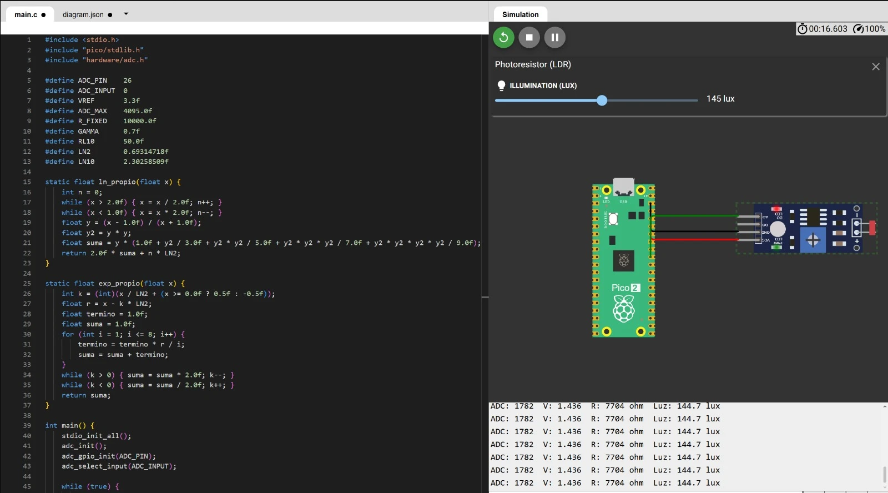
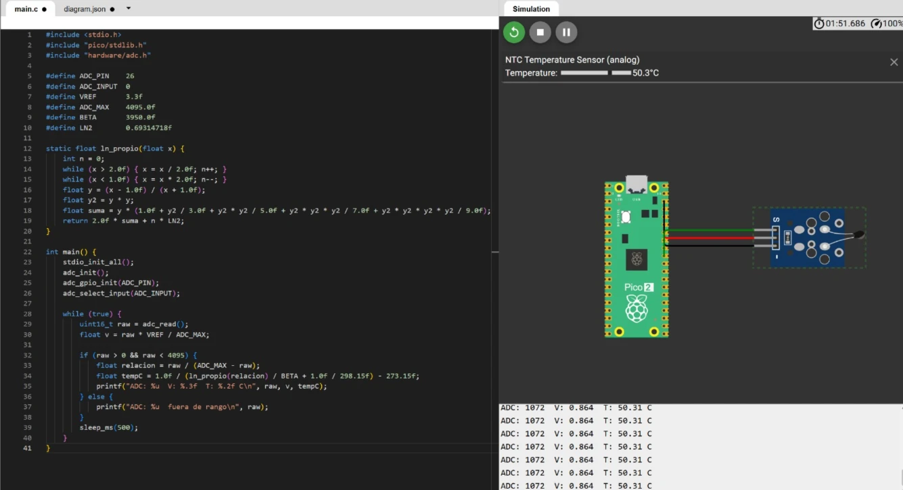
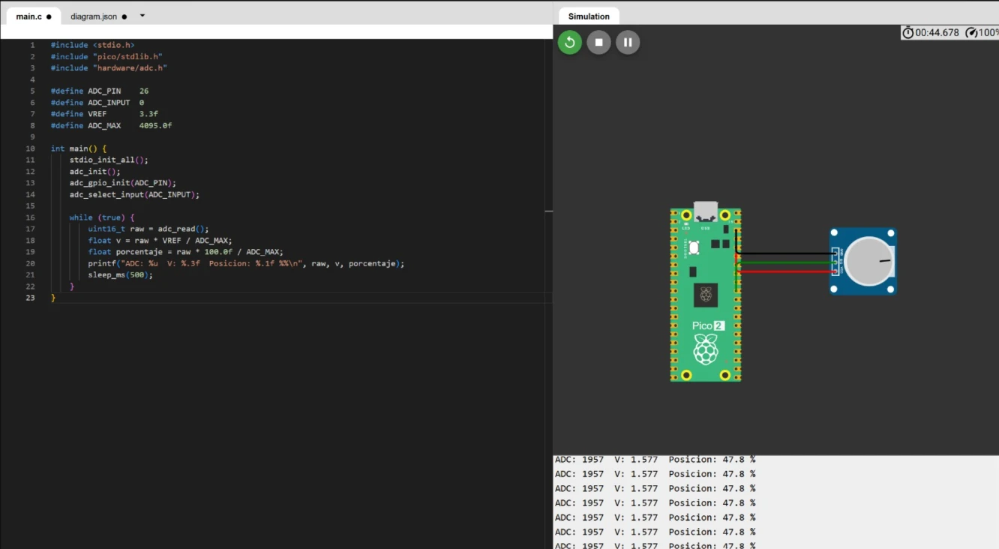

# ADC — Reading a Light Sensor, a Temperature Sensor and a Potentiometer

**Goal (one sentence):** Use the Pico 2's analog-to-digital converter to read three analog sensors — a photoresistor, an NTC thermistor and a potentiometer — and turn each raw reading into a physical value: lux, degrees Celsius and knob position.

**Prediction — written before running anything:** The ADC is 12-bit, so every reading should fall between 0 and 4095 and map linearly to 0–3.3 V. For the potentiometer that voltage is the measurement itself, so the percentage should follow the knob directly. The photoresistor and the thermistor are not linear: each sits in a voltage divider, so the program first has to recover the sensor's resistance from the voltage and only then apply its own equation — the gamma model for the LDR and the Beta equation for the NTC. If the equations are right, the values printed should match the light level and the temperature set in the simulator.

---

### Setup

- Simulated in Wokwi on a Raspberry Pi Pico 2; one sensor at a time.
- Each sensor module powered from 3.3 V and GND, with its analog output on GP26 (`ADC_PIN` = 26, `ADC_INPUT` = 0, i.e. ADC0).
- Conversion constants shared by the three programs: `VREF` = 3.3 V and `ADC_MAX` = 4095.

### What I did

1. Wrote one program per sensor, all starting the same way: `adc_init()`, `adc_gpio_init(ADC_PIN)` to put GP26 in analog mode, and `adc_select_input(ADC_INPUT)` to pick channel 0.
2. In each loop, took a reading with `adc_read()` every 500 ms and converted it to voltage with `raw * VREF / ADC_MAX`.
3. **Potentiometer:** turned the reading into a position from 0 % to 100 % (`raw * 100 / ADC_MAX`) and turned the knob to watch it change.
4. **NTC thermistor:** computed the resistance ratio `raw / (ADC_MAX - raw)` and applied the Beta equation (`BETA` = 3950, referenced to 25 °C = 298.15 K), discarding readings at 0 or 4095 as out of range.
5. **Photoresistor (LDR):** recovered the LDR's resistance from the divider with the 10 kΩ fixed resistor (`R_FIXED`) and converted it to lux with the module's gamma model (`GAMMA` = 0.7, `RL10` = 50 kΩ at 10 lux).
6. Since the logarithm and the exponential were needed without `math.h`, wrote our own `ln_propio` (range reduction by powers of 2 plus a series) and `exp_propio` (range reduction plus a Taylor series).
7. Moved the light and temperature sliders in the simulator and compared them with the values printed on the serial monitor.

### What went wrong

- We lost a lot of time on the first, physical version of the practice: the sensor we used was a different one and it did not work. The code was not the problem — when we moved it to the simulation, everything worked as it should, so we decided to do the whole practice in simulation.

---

## Light sensor (LDR)

### Code

Code: pending — the screenshot below shows lines 1–45 of the program; the rest of the main loop is still to be added.

### Evidence

The simulator's light level is set to 145 lux; the program reads ADC 1782, 1.436 V and a resistance of 7704 Ω, and computes **144.7 lux**.



---

## Temperature sensor (NTC)

### Code

```c
#include <stdio.h>
#include "pico/stdlib.h"
#include "hardware/adc.h"

#define ADC_PIN    26
#define ADC_INPUT  0
#define VREF       3.3f
#define ADC_MAX    4095.0f
#define BETA       3950.0f
#define LN2        0.69314718f

static float ln_propio(float x) {
    int n = 0;
    while (x > 2.0f) { x = x / 2.0f; n++; }
    while (x < 1.0f) { x = x * 2.0f; n--; }
    float y = (x - 1.0f) / (x + 1.0f);
    float y2 = y * y;
    float suma = y * (1.0f + y2 / 3.0f + y2 * y2 / 5.0f + y2 * y2 * y2 / 7.0f + y2 * y2 * y2 * y2 / 9.0f);
    return 2.0f * suma + n * LN2;
}

int main() {
    stdio_init_all();
    adc_init();
    adc_gpio_init(ADC_PIN);
    adc_select_input(ADC_INPUT);

    while (true) {
        uint16_t raw = adc_read();
        float v = raw * VREF / ADC_MAX;

        if (raw > 0 && raw < 4095) {
            float relacion = raw / (ADC_MAX - raw);
            float tempC = 1.0f / (ln_propio(relacion) / BETA + 1.0f / 298.15f) - 273.15f;
            printf("ADC: %u  V: %.3f  T: %.2f C\n", raw, v, tempC);
        } else {
            printf("ADC: %u  fuera de rango\n", raw);
        }
        sleep_ms(500);
    }
}
```

### Evidence

The simulator's temperature is set to 50.3 °C; the program reads ADC 1072 and 0.864 V and computes **50.31 °C**.



---

## Potentiometer

### Code

```c
#include <stdio.h>
#include "pico/stdlib.h"
#include "hardware/adc.h"

#define ADC_PIN    26
#define ADC_INPUT  0
#define VREF       3.3f
#define ADC_MAX    4095.0f

int main() {
    stdio_init_all();
    adc_init();
    adc_gpio_init(ADC_PIN);
    adc_select_input(ADC_INPUT);

    while (true) {
        uint16_t raw = adc_read();
        float v = raw * VREF / ADC_MAX;
        float porcentaje = raw * 100.0f / ADC_MAX;
        printf("ADC: %u  V: %.3f  Posicion: %.1f %%\n", raw, v, porcentaje);
        sleep_ms(500);
    }
}
```

### Evidence

With the knob near the middle, the program reads ADC 1957 and 1.577 V, a position of **47.8 %**.



---

## Results

| Sensor | Set in the simulator | ADC | Voltage | Computed by the program |
|---|---|---|---|---|
| Photoresistor (LDR) | 145 lux | 1782 | 1.436 V | 144.7 lux (R = 7704 Ω) |
| NTC thermistor | 50.3 °C | 1072 | 0.864 V | 50.31 °C |
| Potentiometer | knob near the middle | 1957 | 1.577 V | 47.8 % |

### Open Question

Both `ln_propio` and `exp_propio` stop their series after a fixed number of terms, and the readings already land within 0.3 lux and 0.01 °C of the simulator. How much of the remaining difference comes from truncating those series, and how much from the ADC itself — its 12-bit step of about 0.8 mV, which turns into a much larger change in lux or degrees at the ends of the range, where the curves are steepest? Would averaging several readings help more than adding terms to the series?
